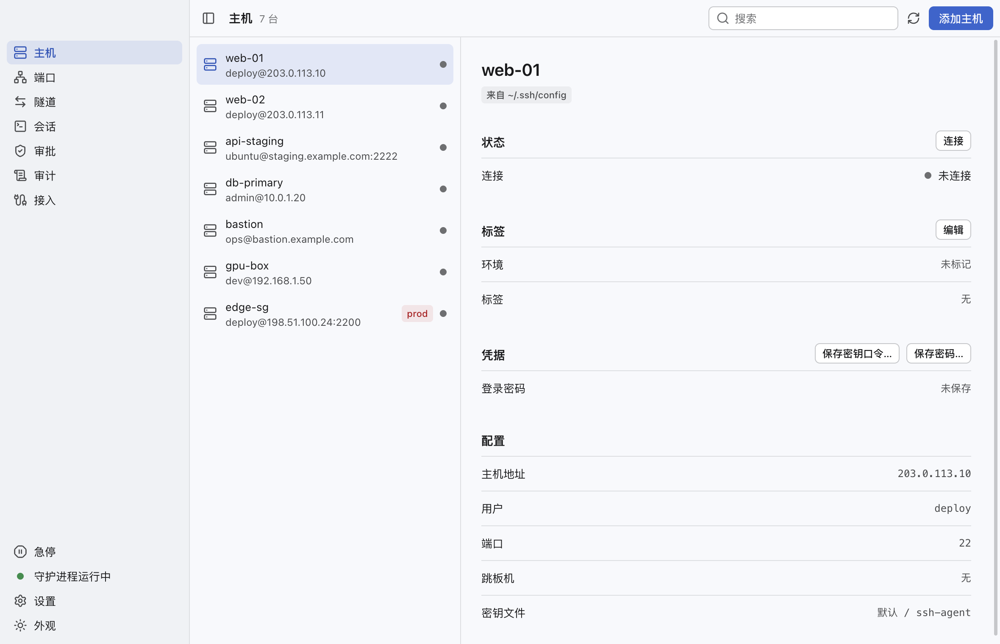
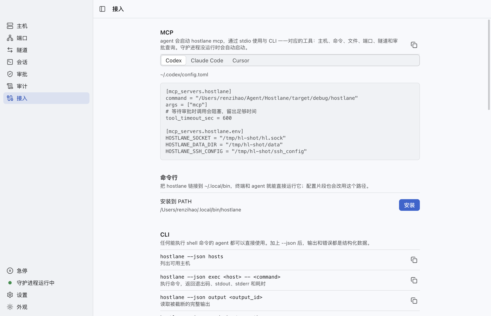

<div align="center">
  <h1>Hostlane</h1>
  <p><b>English</b> · <a href="README.zh-CN.md">简体中文</a></p>
  <p>An SSH runtime for the agent you already use. Let Codex, Claude Code or your own agent run commands, edit files, open tunnels and manage web-service ports on remote servers — from your machine, with fingerprint checks, approvals and an audit trail.</p>
  <p>No built-in LLM. Nothing to install on the server: <code>sshd</code> is enough.</p>
  <p>
    
    
    
    
    
    
  </p>
  <p>
    <a href="#quick-start">Quick start</a> ·
    <a href="#use-it-from-your-agent">Use it from your agent</a> ·
    <a href="#roadmap">Roadmap</a> ·
    <a href="docs/architecture.md">Architecture</a> ·
    <a href="#faq">FAQ</a>
  </p>
</div>

> [!WARNING]
> Hostlane is in early development. M0–M1 work today: the daemon, CLI, `~/.ssh/config` import, a pooled SSH client with host key checks, `exec`, the session monitor and the audit log. Files, ports, tunnels and approvals arrive in M2–M6. See the [roadmap](#roadmap).

<picture>
  <source media="(prefers-color-scheme: dark)" srcset="docs/screenshots/hosts-dark.png" />
  
</picture>

<table>
  <tr>
    <td></td>
    <td></td>
  </tr>
</table>

<sub>Screenshots use a sample <code>ssh_config</code> with made-up hosts. The desktop UI copy is currently in Chinese.</sub>

## Why

Agents are good at operating servers, but the tools around them fall short. Terminal apps like Chaterm and Warp bring their own LLM. VS Code Remote-SSH and Claude Code's SSH mode install a runtime on the server. Existing SSH MCP servers leave out safe file edits, long-running jobs, approvals or multi-host work. Hostlane gives **your** agent the hands and keeps the brain with you:

- **Bring your own agent.** Hostlane has no model and calls no model API. Any agent that can run a shell command or speak MCP can use it.
- **Nothing on the server.** Only `sshd`, a POSIX shell and SFTP. Enhanced tools (`rg`, `tmux`, `docker`) are used when present, with automatic fallbacks.
- **Safe by design.** Host fingerprints are checked and pinned, commands are classified by risk, risky operations wait for your approval, and every call lands in a local append-only audit log. A global stop switch pauses all agent activity.
- **Edits you can trust.** File patches check a hash first, back up the original, upload to a temp file and swap atomically, keeping permissions and ownership.
- **Built for web services.** See which ports listen on each server, which process, systemd unit or Docker container owns them, whether they answer HTTP, and forward them to your machine in one click.
- **One daemon, many clients.** A small resident Rust daemon owns the SSH connections, tunnels and approval queue. The CLI, MCP server and desktop app all share it, and the desktop app can be closed at any time.
- **Watch, don't type.** The session monitor is a read-only terminal: you see every command, its output, exit code and duration, live or replayed.

## How it works

```text
your agent ──CLI / MCP──┐
                        ▼
Electron UI ──IPC──► main process ──local socket──► hostlane daemon ──SSH/SFTP──► servers
                                                    ├─ connection pool
                                                    ├─ exec / background jobs
                                                    ├─ file operations
                                                    ├─ tunnels
                                                    ├─ port discovery
                                                    ├─ policy engine / approvals
                                                    └─ audit log (SQLite)
```

- `hostlane` is a single binary: the CLI, the daemon (`hostlane daemon …`) and, later, the MCP server (`hostlane mcp`).
- Clients talk to the daemon over newline-delimited JSON-RPC 2.0 on a per-user socket with `0600` permissions.
- Errors carry a stable `kind` and a `hint` written for agents, so they can decide the next step without parsing prose.

Details: [architecture and protocol](docs/architecture.md) (Chinese).

## Quick start

There are no prebuilt binaries yet; build from source.

**Requirements:** Rust 1.89+, Node.js 22.12+ and npm 10+.

```bash
git clone https://github.com/rzh-98/Hostlane.git && cd Hostlane

# Daemon + CLI (tests also regenerate the desktop's TypeScript protocol types)
cargo build
cargo test --workspace

./target/debug/hostlane daemon start
./target/debug/hostlane hosts
./target/debug/hostlane trust <host>              # first connection: verify and trust the host key
./target/debug/hostlane exec <host> -- uname -a
./target/debug/hostlane daemon stop

# Desktop app (development mode uses target/debug/hostlane and starts the daemon if needed)
cd apps/desktop
npm install
npm run dev
```

### CLI

Every command accepts `--json`. On success, the result goes to stdout; on failure, the exit code is 1 and stdout holds `{"error":{"kind","message","hint"}}`.

| Command                                                                            | What it does                                                                                  |
| ---------------------------------------------------------------------------------- | --------------------------------------------------------------------------------------------- |
| `hostlane status`                                                                  | Show whether the daemon is running, its version, PID and socket                               |
| `hostlane hosts`                                                                   | List hosts from `~/.ssh/config` (`Include`, wildcard blocks and first-value-wins are honored) |
| `hostlane exec <host> [--cwd DIR] [--env K=V] [--timeout SECS] [--stdin] -- <cmd>` | Run a command on a host. Without `--json`, the exit code is the remote one (124 on timeout)   |
| `hostlane output <output_id> [--stream stderr] [--offset N]`                       | Read the full output of a truncated command (negative offsets count from the end)             |
| `hostlane trust <host> [--fingerprint SHA256:…]`                                   | Verify and trust a host key, recorded in Hostlane's own `known_hosts`                         |
| `hostlane connect` / `disconnect <host>`                                           | Open or close the connection to a host                                                        |
| `hostlane connections`                                                             | Show connection state, latency, open channels and host keys                                   |
| `hostlane watch [--host H]`                                                        | Follow every command agents run, with live output (read-only)                                 |
| `hostlane history`                                                                 | Recent commands                                                                               |
| `hostlane audit [--host H] [--client C]`                                           | Show the audit log                                                                            |
| `hostlane call <method> '<params>'`                                                | Send a raw JSON-RPC call to the daemon                                                        |
| `hostlane daemon start` / `stop`                                                   | Start the daemon in the background, or ask it to exit                                         |
| `hostlane daemon run`                                                              | Run the daemon in the foreground                                                              |
| `hostlane daemon socket-path`                                                      | Print the socket path clients use                                                             |

### Environment variables

| Variable              | Effect                                                                              |
| --------------------- | ----------------------------------------------------------------------------------- |
| `HOSTLANE_SOCKET`     | Override the socket path                                                            |
| `HOSTLANE_DATA_DIR`   | Override the data directory (logs, database)                                        |
| `HOSTLANE_SSH_CONFIG` | Override the `ssh_config` path                                                      |
| `HOSTLANE_BIN`        | The `hostlane` binary used by the desktop app                                       |
| `HOSTLANE_CLIENT`     | Caller name for CLI calls (default `cli`), shown in the audit log and Sessions page |
| `HOSTLANE_SESSION`    | Agent session ID; the Sessions page groups by it                                    |

To try things without touching your real setup, point all of them at a temporary directory:

```bash
export HOSTLANE_SOCKET=/tmp/hl/hostlane.sock HOSTLANE_DATA_DIR=/tmp/hl HOSTLANE_SSH_CONFIG=/tmp/hl/ssh_config
```

## Use it from your agent

Until the MCP server lands in M6, agents use the CLI. Add this to your project's `AGENTS.md` or `CLAUDE.md`:

```markdown
## Remote servers

Operate servers through the `hostlane` CLI; do not run ssh directly.

- Run `hostlane --json hosts` first to see the available hosts.
- Run commands with `hostlane --json exec <host> [--cwd DIR] [--timeout SECS] -- <command>`.
- Long output is truncated (`truncated: true`); read all of it with `hostlane --json output <output_id>`.
- Always pass `--json`; on failure, read error.kind and error.hint to decide the next step.
- On HOST_KEY_UNKNOWN or HOST_KEY_CHANGED, stop and tell the user; never trust a host key yourself.
- Set `HOSTLANE_CLIENT=<agent name>` and `HOSTLANE_SESSION=<session id>` so the audit log and Sessions page can tell callers apart.
```

The desktop app's Integrations page has the same snippet with a copy button. In M6 it will also provide ready-made MCP config for Codex, Claude Code and Cursor.

## Roadmap

| Milestone                 | Scope                                                                                        | Status  |
| ------------------------- | -------------------------------------------------------------------------------------------- | ------- |
| **M0** Skeleton           | Rust workspace, daemon, local socket JSON-RPC, CLI, `~/.ssh/config` import, desktop shell    | ✅ Done |
| **M1** Connect & exec     | `russh` connection pool, host fingerprint checks, `exec`, session monitor, audit log         | ✅ Done |
| **M2** Files              | `read_file`, `list_dir`, `search`, `apply_patch`, `write_file`                               | Next    |
| **M3** Ports              | Port discovery, process mapping, HTTP probing, port notes, free-port lookup                  | Planned |
| **M4** Tunnels            | Local forwarding, saved tunnels, auto-reconnect, conflict detection, temporary agent tunnels | Planned |
| **M5** Policy             | Risk levels, rules, blocking approvals, global stop                                          | Planned |
| **M6** MCP & distribution | `hostlane mcp`, Integrations page, user-level service registration, bundled binary           | Planned |

The full requirement list, with IDs and priorities, is in [docs/requirements.md](docs/requirements.md) (Chinese).

## Project structure

```text
├─ Cargo.toml                  Rust workspace
├─ crates/
│  ├─ hostlane-protocol/       Wire types: JSON-RPC frames, error codes, method params and results
│  ├─ hostlane-core/           Daemon: socket server, SSH pool, exec, audit (SQLite), client
│  └─ hostlane-cli/            The `hostlane` binary: CLI + `daemon` subcommands
├─ apps/desktop/               Electron app, based on Desktop-Starter
│  └─ src/
│     ├─ main/daemon.ts        Connects to the daemon, starts it on demand, forwards events
│     ├─ shared/protocol/      TypeScript types generated from hostlane-protocol (do not edit)
│     └─ renderer/src/pages/   Hosts, Ports, Tunnels, Sessions, Approvals, Audit, Integrations, Settings
└─ docs/                       Requirements, architecture, screenshots
```

Dependencies point one way: `hostlane-cli → hostlane-core → hostlane-protocol`. The desktop app depends only on the generated TypeScript types.

## Development

```bash
# Rust
cargo fmt --all
cargo clippy --workspace --all-targets
cargo test --workspace

# Desktop (in apps/desktop)
npm run typecheck
npx prettier --write src
```

- Adding a JSON-RPC method takes five steps; see [Adding a method](docs/architecture.md#新增一个方法).
- The desktop UI follows the [design system](apps/desktop/docs/design-system.md). `ui/` and `layout/` contain no product code.
- The socket path rules live in both `crates/hostlane-core/src/paths.rs` and `apps/desktop/src/main/paths.ts`. Keep them in sync.

## Security

- The local socket is readable only by the current user (`0600`, inside a `0700` directory).
- SSH keys, passwords and audit data stay on your machine. Credentials never reach the renderer process and are never logged.
- A person must verify and trust a host key on first connection. A changed key blocks the connection, and neither agents nor `hosts.trust` can override it. Hostlane writes only its own `known_hosts` and never touches `~/.ssh/known_hosts`.
- The audit log is append-only: database triggers reject updates and deletes.
- Authentication uses ssh-agent or unencrypted key files; `ssh-add` passphrase-protected keys first. Password login is not supported yet.
- The renderer runs sandboxed and can call only an explicit allowlist of daemon methods.
- Hostlane sends no telemetry and talks to nothing except your servers.

## FAQ

<details>
<summary>Why not just let the agent run <code>ssh</code>?</summary>

It works until it doesn't: a new connection per command, no host-key policy, `sed -i` edits with no backup, nothing between the agent and `rm -rf` on production, and no record of what happened. Hostlane keeps one pooled connection per host and adds safe edits, approvals, tunnels and an audit log on top.

</details>

<details>
<summary>Does Hostlane install anything on my servers?</summary>

No. It uses only `sshd`, a POSIX shell and SFTP. When tools like `rg`, `tmux` or `docker` are present, Hostlane uses them; otherwise it falls back to `grep`, `nohup` and so on.

</details>

<details>
<summary>Which LLM does it use?</summary>

None. Hostlane is the runtime; the agent you already use is the brain.

</details>

<details>
<summary>Can I type into the session terminal?</summary>

No, by design. The session monitor is read-only so that everything that happens on a server goes through the same policy checks and audit log.

</details>

<details>
<summary>Kubernetes? Windows?</summary>

Port management covers systemd, Docker and docker-compose; Kubernetes is out of scope for now. macOS and Linux are the primary targets today; Windows named-pipe support is planned for V1.

</details>

## Scope

Hostlane **does not** include an LLM, team collaboration or cloud sync, Kubernetes support, or human input in the terminal. It focuses on being a small, safe, local runtime that any agent can drive.

## License

[MIT](LICENSE)
